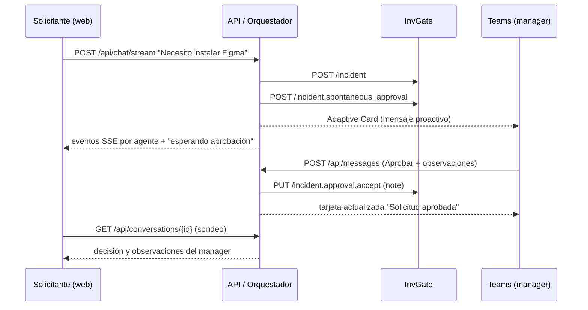

# Arquitectura C4

## Nivel 1 — Contexto

El **solicitante** conversa con el **sistema Valkiria InvGate PoC**. El sistema gestiona tickets en **InvGate Service Management** y pide las aprobaciones al **manager** por **Microsoft Teams**. Las trazas se envían opcionalmente a **Langfuse**, y el LLM puede ser local (**Ollama/Jan**).

## Nivel 2 — Contenedores

- **API (FastAPI):** expone `/api/chat`, `/api/chat/stream` (SSE por agente), `/api/conversations`, `/api/escalate`, `/api/approvals`, `/api/metrics`, `/api/audit/verify`, `/api/messages` (Bot Framework) y `/api/health`. También sirve el frontend.
- **Orquestador multiagente:** el Coordinador ejecuta en orden a Clasificador, Diagnóstico, Políticas, Ejecución, Conocimiento, Seguimiento y Escalación. Cada uno reporta `ok`, `warning` o `error`.
- **Adaptador InvGate:** cliente de la API v1 (`/incident`, `/incident.comment`, `/incident.spontaneous_approval`, `/incident.approval.accept|reject`, catálogos), con API token u OAuth2, reintentos con backoff y mapeo de campos y valores.
- **Proveedores de ticketing:** `demo` (memoria), `simulated` (archivo JSON) e `invgate` (real, con aprobaciones nativas).
- **Servicio de aprobaciones:** TTL, una sola decisión, solo el manager vota, y sincroniza con el proveedor antes de dar la decisión por buena.
- **Bot de Teams:** guarda la conversación del manager, envía la Adaptive Card de forma proactiva y procesa Aprobar/Rechazar con observaciones.
- **Frontend web:** chat con semáforo en vivo, tarjeta del ticket, decisión y observaciones del manager, y dashboard de 4 dimensiones.
- **Observabilidad:** telemetría JSONL, métricas agregadas, audit trail encadenado por hash y Langfuse opcional.

## Nivel 3 — Componentes (API)

```
backend/
  agents/          Orquestador, diagnóstico, base de conocimiento y modelos
  approvals/       Servicio de aprobaciones con TTL, decisión única y persistencia
  invgate/         Cliente HTTP (token/OAuth2), modelos y mapeo de InvGate
  llmops/          LLM mock, cliente OpenAI-compatible (Ollama/Jan) y respaldo
  observability/   Telemetría JSONL, métricas del dashboard y exportador a Langfuse
  routes/          chat, approvals, admin (métricas y auditoría) y teams
  security/        RBAC por API key, rate limit, redacción de PII y audit trail
  teams/           Bot, Adaptive Cards, notificadores y referencias de conversación
  ticketing/       Proveedores demo/simulated/invgate y fábrica
  runtime.py       Dependencias compartidas por proceso
scripts/           seed_demo_telemetry (demo del dashboard) y check_invgate (prueba real)
infra/             Manifiesto de la app de Teams
```

## Flujo de una solicitud con aprobación


